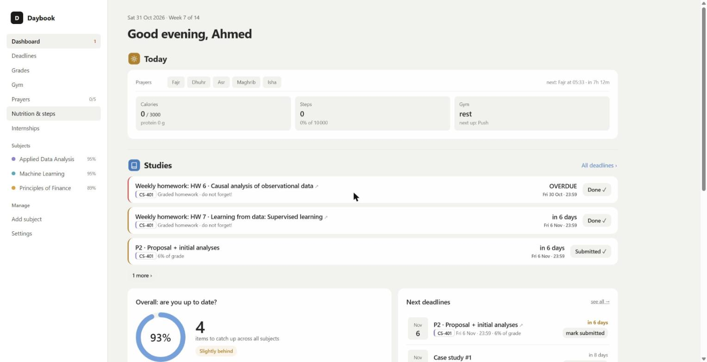

# Daybook

A personal dashboard I use every day during my MSc at EPFL: course checklists and deadlines, grades,
gym program, prayer times, nutrition and steps, and internship applications. It runs as an installable
web app on my laptop and phone, synced between devices.



*Demo data. The real course data, nutrition history and applications are not in this repository.*

## Features

- **Courses**: one checklist item per lecture, exercise session and homework, for each teaching week.
  Progress rings, "are you up to date?" stats and a merged list of upcoming deadlines.
- **Grades**: each course's grading scheme with a what-if calculator.
- **Gym**: training program, logged sets and body-weight / progression charts (inline SVG, no library).
- **Prayers**: daily ticks, streaks and a heatmap. Prayer times are computed offline from the sun's
  position for Lausanne (configurable method and Asr school), no API.
- **Nutrition & steps**: calories, macros and steps pulled every hour from Yazio by the server.
- **Internships**: application pipeline with one CV track per application (data, software, security, finance).
- **Push notifications** for prayer times and deadlines (24 h and 3 h before), skipped if already ticked.
- Dark / light / auto theme, desktop sidebar or mobile tab bar, works offline.

## How it is built

No framework and no build step: plain HTML, CSS and JavaScript (about 20 small classic scripts sharing
one global scope, loaded in order by `index.html`).

```
browser / phone (PWA)                     Cloudflare Worker  (hosting/worker.js)
  js/*.js  state in localStorage   <--->  /api/state    KV "state": newest savedAt wins,
  sw.js    offline cache per deploy                     daily backups kept 35 days
  notify.js builds a push plan     ---->  cron, every 5 min: sends due Web Push notifications
                                           (VAPID JWT signed with WebCrypto, aes128gcm payload)
                                   <----  cron, hourly: Yazio API -> /js/food-data.js
```

- **Sync**: the whole app state is one JSON document. Each device pushes it after changes and pulls on
  start; the most recent `savedAt` wins, and a device that never synced takes the server copy.
- **Auth**: a passphrase login page; the session cookie is an HMAC of the passphrase (HttpOnly, Secure),
  compared in constant time.
- **Web Push without a library**: the Worker signs the VAPID JWT (ES256) and encrypts each payload
  (ECDH + HKDF + AES-128-GCM, RFC 8291) with the WebCrypto API.
- **Offline**: `deploy.ps1` stamps the service worker with a version and the list of files, so each
  deploy is cached once and the app opens instantly without network.
- **Course data** (`js/data.js`) is versioned: when `SEED_VERSION` goes up, `load()` merges new topics,
  links and deadlines into the saved state without losing checkmarks (item ids stay stable).
- **Backups**: a daily JSON export into a folder picked once (File System Access API, handle kept in
  IndexedDB), with a download fallback.

## Run it

Locally: open `index.html` in Chrome (works over `file://`, state stays in the browser).

Hosted on Cloudflare:

```powershell
cd hosting
npx wrangler kv namespace create DB      # paste the id into wrangler.toml
npx wrangler secret put PASSPHRASE
# optional: YAZIO_USER, YAZIO_PASS, YAZIO_CLIENT_ID, YAZIO_CLIENT_SECRET (nutrition sync)
#           VAPID_PRIVATE_JWK, VAPID_SUBJECT (push; the public key is in js/notify.js)
./deploy.ps1
```

The Yazio integration uses Yazio's unofficial API and is for personal use only.
